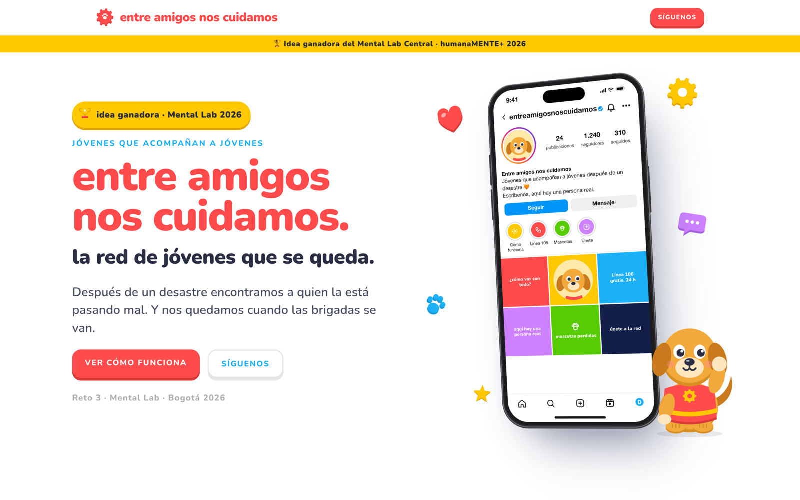

# Entre amigos nos cuidamos

**Idea ganadora del Mental Lab Central** (Reto 3 GRIS, hackathon humanaMENTE+, Universidad de La Sabana y Fundación I+D, Bogotá, 22 de octubre de 2026).

- 🌐 **Página:** [espinosacodes.com/mentallab](https://espinosacodes.com/mentallab)
- 🎞️ **Presentación (deck de 12 diapositivas):** [espinosacodes.com/mentallab/presentacion](https://espinosacodes.com/mentallab/presentacion)
- 🎥 **Transmisión en vivo del Foro humanaMENTE+ (Fundación I+D):** [ver en YouTube desde 8:53:40](https://youtu.be/wRBOx4fp9YE?t=32020)
- 🤝 **Con el expresidente de Colombia Iván Duque** ([@ivanduquemarquez](https://www.instagram.com/ivanduquemarquez)): [ver en YouTube desde 8:55:45](https://youtu.be/wRBOx4fp9YE?t=32145)
- 📸 Instagram: [@espinosacodes_](https://www.instagram.com/espinosacodes_) · [@fimasd_org](https://www.instagram.com/fimasd_org) (Fundación I+D)

## El reto

> ¿Cómo podríamos ayudar a los jóvenes afectados por desastres naturales a reconocer y afrontar las consecuencias emocionales de la pérdida, el miedo y la incertidumbre, y a recuperar sus redes de apoyo después de una crisis?

La solución tenía que fortalecer lo que ya hacen las autoridades locales y venir desde los propios jóvenes. Reglas: nada que reemplace la atención profesional, nada de diagnósticos ni terapias y ninguna dinámica que pida testimonios de sufrimiento.

## La idea

Una red de estudiantes de servicio social (grados 10 y 11) y voluntarios jóvenes que quieren estudiar carreras de salud. Los forman universitarios en práctica en Primeros Auxilios Psicológicos y los supervisa el psicólogo de la alcaldía. Después de un desastre:

1. **Ubican** a cada joven afectado. Un amigo puede avisar ("¿A alguien le pasó algo?") compartiendo un meme o una historia triste con la cuenta de la red.
2. **Priorizan** con un semáforo (verde, amarillo, rojo) que siempre confirma un profesional. El rojo lo atiende un psicólogo el mismo día.
3. **Conectan** con lo que ya existe: EPS, alcaldía, ICBF, colegio, Línea 106 y centros de bienestar animal.
4. **Se quedan** cuando las brigadas se van, durante el primer año.

Su rol es observar, escuchar y conectar. Nunca hacer terapia. Alrededor de la red hay un aterrizaje emocional para recuperar el "ancla" (la casa como metáfora), formación a familias y profesores, el duelo por mascotas y el proyecto de vida. El detalle completo está en [`solucion.md`](solucion.md).

## Qué hay en el repo

| Carpeta o archivo | Contenido |
|---|---|
| [`solucion.md`](solucion.md) | La solución final consolidada. **Empieza aquí** |
| [`investigacion/`](investigacion/README.md) | Marco legal colombiano, casos y actores, evidencia internacional, psicólogos y brigadas en el Chocó, financiación y duelo por mascotas, con datos verificados y no verificados separados |
| [`ideation/`](ideation/) | Documento principal del reto, notas de la sesión, 35 ideas por actor, iceberg, mapa del problema y matriz de convergencia (diagramas en Mermaid y PNG) |
| [`prototipo/`](prototipo/README.md) | Hipótesis, perfiles, storyboard, blueprint, role-play, maqueta LEGO, one pager, ficha de solución, pitch final y las dos páginas web |
| `prototipo/landing.html` | Código de la landing publicada en espinosacodes.com/mentallab |
| `prototipo/prototipo.html` | Código del deck publicado en /mentallab/presentacion |
| `prototipo/prompt-prototipo.md` | El prompt que generó el deck, con la mascota Piñón |
| [`formulario-pitch.md`](formulario-pitch.md) | Lo que se llenó en el formulario oficial de proyectos |
| `*.pdf` | Presentación oficial del taller y ficha técnica con la rúbrica |
| [`AGENTS.md`](AGENTS.md) | Contexto y reglas para los agentes de IA que trabajaron en la carpeta |

## Cómo lo hicimos con IA

Todo el reto se trabajó en vivo, durante el día del evento, con **Claude Code** (Claude Opus) corriendo en el portátil sobre esta misma carpeta. La IA no reemplazó al equipo ni a los facilitadores: el equipo decidía y la IA investigaba, ordenaba y producía los materiales.

### 1. Grabar lo que se decía

Las instrucciones de los facilitadores se grabaron y se pasaron por transcripción automática. La transcripción tenía mucho ruido, así que la IA la limpió y la convirtió en notas accionables: la palabra clave "renuncia", la divergencia hasta las 12:50, los 8 métodos de ideación y cómo converger. Quedó en [`ideation/notas-sesion-ideacion.md`](ideation/notas-sesion-ideacion.md). Así cada fase del taller tenía el contexto exacto de lo que pedían.

### 2. Darle contexto a la IA

Se cargaron los dos PDF oficiales (presentación de 112 páginas y ficha técnica con la rúbrica) y se escribió [`AGENTS.md`](AGENTS.md): qué es el reto, cómo califican (comprensión sistémica 25 %, pertinencia juvenil 20 %, innovación 20 %, viabilidad 20 %, prototipo y pitch 15 %), las reglas que no se pueden romper y las convenciones de escritura. Cada conversación nueva con la IA arrancaba leyendo ese archivo.

### 3. Investigar

Con la IA se investigó el marco legal colombiano (por ejemplo la Ley 2460 de 2025 de agentes comunitarios en salud mental), lo que pasó con las brigadas en el Chocó, modelos internacionales de apoyo entre pares, de dónde saldría la plata del piloto y el duelo por mascotas. Cada dato quedó marcado como verificado o no verificado en [`investigacion/`](investigacion/README.md).

### 4. Idear y converger

Siguiendo los métodos del taller, la IA ayudó a generar 35 ideas por actor, el mapa de empatía, la flor de loto, "buena idea, mala idea", las ideas compuestas y la matriz de convergencia ([`ideation/divergencia.md`](ideation/divergencia.md)). El iceberg, el mapa del problema y el punto de apalancamiento se dibujaron en Mermaid. El equipo eligió la idea y la IA la consolidó en [`solucion.md`](solucion.md).

### 5. Prototipar

Para la fase Experimentar se produjeron el storyboard, el blueprint de servicio, el journey, el mapa de actores, el guion del role-play, la maqueta LEGO, el one pager y la ficha de solución ([`prototipo/`](prototipo/README.md)).

Para el pitch, la IA escribió un prompt ([`prompt-prototipo.md`](prototipo/prompt-prototipo.md)) a partir de una grabación de pantalla de la landing de Duolingo como referencia de estilo y una foto de un iPhone. Después ejecutó ese prompt y construyó el deck de 12 diapositivas: un iPhone con Instagram donde una amiga comparte la historia triste de Yeison a las 2:07 a. m., la red le escribe y el caso queda en el tablero del psicólogo. Al lado está Piñón, un golden retriever con chaleco rojo de rescatista. Lo revisó con capturas en un navegador real y lo publicó en espinosacodes.com con un QR para el jurado.

### 6. Pitch y después

La IA preparó el pitch de 3 minutos con tiempos y reparto, versiones de 1 minuto para la final y las preguntas probables del jurado ([`pitch-final.md`](prototipo/pitch-final.md)). Tras ganar, el deck se convirtió en una landing con scroll, el sello de idea ganadora y los Instagram del equipo y de la Fundación I+D.

### Reglas que se le pusieron a la IA

- Todo el contenido en español y sin rayas largas.
- Separar siempre lo verificado de lo no verificado.
- Respetar las reglas del reto: ni diagnósticos, ni terapia, ni testimonios de sufrimiento.
- Nada se publicaba ni se enviaba sin que el equipo dijera que sí.

## Si tú o alguien que conoces está en riesgo

**Línea 106**, gratis, 24 horas.
