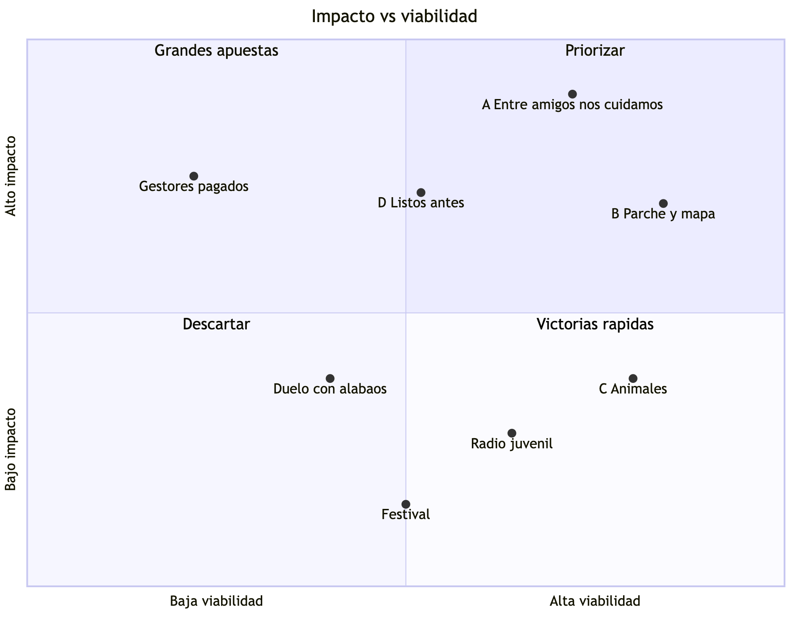

# Divergencia: ideas para el Reto 3

Material para la sesión de ideación (hasta las 12:50). Sigue las reglas de los facilitadores (ver `notas-sesion-ideacion.md`): muchas ideas, distintas entre sí, en espacios distintos y con actores distintos. **La red de servicio social es una idea más de la lista, no la ganadora todavía.**

Todas respetan las reglas del reto: nada reemplaza al profesional, nada diagnostica, nada se basa solo en prohibir y nada pide testimonios de sufrimiento.

El número entre corchetes indica el archivo de `investigacion/` que respalda la idea.

---

## 1. Mapa de empatía del joven afectado (14 a 28 años)

| Dice | Hace |
|---|---|
| "Estoy bien, hay gente peor" | Deja de ir al colegio o llega sin ganas |
| "No quiero ir al psicólogo, no estoy loco" | Se queda en el celular hasta tarde, no duerme |
| "Mi perro sigue perdido" | Ayuda en la casa y en la reconstrucción como un adulto más |
| "Me tocó irme del barrio y ya no veo a mis amigos" | Se aísla o se junta con otros jóvenes que no conoce |
| "Cada temblor me pongo mal" | Revisa grupos de WhatsApp buscando noticias |

| Pide | Tiene |
|---|---|
| Volver a la normalidad: colegio, fútbol, amigos | Celular y WhatsApp |
| Saber qué va a pasar (casa, colegio, familia) | Amigos y compañeros, aunque dispersos |
| Que no lo traten como niño | Ganas de ayudar y de ser útil |
| Hablar con alguien de su edad que entienda | Tiempo libre por el cierre del colegio |
| Que alguien busque a su mascota | Cultura propia: música, alabaos, río, fútbol |

**Ideas que salen de conectar los cuatro frentes:** dar al joven un rol útil (lo pide y tiene ganas), usar su celular como herramienta (lo tiene), recuperar rutinas con pares (lo pide), y no llamarlo "atención psicológica" (lo rechaza).

---

## 2. Flor de loto: el reto en el centro

```
              Rutinas        Información      Vínculos
                    \            |            /
   Preparación  ---   ¿Cómo ayudamos a los jóvenes a   ---  Duelo
                       afrontar la pérdida y recuperar
                       sus redes después del desastre?
                    /            |            \
          Autoridades        Colegio          Familias
```

Cada pétalo abre ideas de la lista:

| Pétalo | Ideas |
|---|---|
| Rutinas | 6, 8, 2 |
| Información | 3, 27, 28 |
| Vínculos | 1, 4, 11, 20 |
| Duelo | 16, 18, 22 |
| Familias | 14, 15 |
| Colegio | 7, 9, 10 |
| Autoridades | 12, 13, 29, 30 |
| Preparación | 6, 31, 32 |

---

## 3. Lista de ideas por actor

### Jóvenes afectados

1. **Red de pares de servicio social.** Estudiantes de 10 y 11 formados en Primeros Auxilios Psicológicos, supervisados por el psicólogo municipal y activados por el Consejo Municipal de Gestión del Riesgo. Escuchan, acompañan y remiten. [01, 03]
2. **"El parche vuelve".** Jóvenes organizan fútbol, música y baile en el albergue o en el barrio, a la misma hora todos los días, para recuperar la rutina. No es terapia: es volver a juntarse. [03]
3. **Radio y podcast juvenil de la emergencia.** Jóvenes producen un programa en la emisora comunitaria o por WhatsApp: qué pasa con el colegio, dónde hay ayuda, qué se siente normal sentir. Ataca la incertidumbre con información. [02]
4. **"Mi mapa de apoyo".** Una actividad de una hora donde cada joven reconstruye su red: a quién tenía, dónde está ahora y cómo contactarlo. Sirve para recuperar redes rotas por la reubicación, sin pedir que cuente lo que vivió. [03]
5. **Jóvenes de 18 a 28 como gestores de recuperación pagados.** Como "Parceros por Bogotá": un apoyo económico mensual a jóvenes que trabajan en la reconstrucción y en actividades comunitarias. Da propósito e ingreso al grupo que el ICBF no cubre. [05]

### Colegio

6. **Simulacro con componente emocional.** El simulacro anual del Plan Escolar de Gestión del Riesgo agrega una estación de "qué hago con el miedo" y "a quién busco". [01]
7. **Salón refugio temporal.** Un salón tranquilo en cada colegio afectado durante los primeros meses, como la "Sala Refugio Socioemocional" del Colegio Las Margaritas en Bogotá. [02]
8. **Primera semana de regreso diseñada por estudiantes.** Los estudiantes diseñan cómo es la primera semana de clases después del desastre: menos evaluación, más reencuentro. [02, 03]
9. **Semáforo de asistencia.** El colegio comparte con la ESE la lista de quienes dejaron de ir. La ausencia es la señal temprana de aislamiento y de abandono escolar. [01]
10. **Comité escolar de salud mental activado en emergencias.** Usar el comité que crea la Ley 2460 (Secretaría de Salud más colegio) como centro de mando de lo emocional en cada colegio. [01]

### Alcaldía, Consejo de Gestión del Riesgo y Secretaría de Salud

11. **Censo de jóvenes, no de hogares.** Los pares ubican a cada compañero después de la reubicación y le pasan el dato a la alcaldía, que hoy solo registra jefes de hogar. [02]
12. **Tablero para el psicólogo municipal.** Una hoja o formulario donde llegan los casos que remite la red, con prioridad. El único psicólogo del municipio se enfoca en quien de verdad lo necesita. [04]
13. **Protocolo de entrega de casos cuando la brigada se va.** Antes de irse, la brigada (MSF, Cruz Roja, ICBF, universidades) entrega a la red local los casos con consentimiento, las señales de alarma y la ruta. Ataca el "solo duró unas semanas". [04]
### Familias

14. **Jóvenes que enseñan a sus padres.** Un taller corto, dado por jóvenes con el psicólogo, para que los padres sepan cómo hablar del miedo con sus hijos. Invierte el rol de quién enseña a quién. [03]
15. **Guía de señales para cuidadores por WhatsApp.** Una tarjeta simple: cuándo preocuparse (no duerme, no come, no va al colegio, se aísla) y a dónde llamar (106, 141, ESE). [01, 02]

### Comunidad, cultura y territorio étnico

16. **Rituales de memoria organizados por jóvenes.** Murales, siembra de árboles y aniversarios, consultados con la comunidad y siempre voluntarios. [03]
17. **Jóvenes intérpretes culturales.** Jóvenes Embera y afro acompañan a las brigadas que llegan de afuera como traductores de lengua y de costumbres. [04]
18. **Duelo con alabaos y prácticas del Pacífico.** Jóvenes trabajan con cantadoras y sabedores para que el duelo colectivo use las formas propias de la región (alabaos, gualíes), no solo formatos traídos de la ciudad. [04]
19. **Red con parteras y lideresas.** Conectar la red juvenil con las redes de mujeres que ONU Mujeres ya apoya en Quibdó. [04]

### Brigadas y universidades

20. **Padrinos a distancia.** Cada psicólogo voluntario que atendió de forma remota (como los más de 900 de la Konrad Lorenz) adopta a un grupo de pares por 6 meses y los supervisa por videollamada. [04]
21. **Practicantes de la Universidad Tecnológica del Chocó como supervisores locales.** Dan continuidad aunque el contrato del psicólogo municipal se acabe. [04]

### Mascotas y animales

22. **Despedida de animales en el colegio.** Un muro de fotos o un árbol para los animales que murieron, voluntario. La pregunta "¿tenías algún animal?" entra en la ficha de primer contacto. [06]
23. **Red juvenil de reencuentro de mascotas.** Jóvenes toman fotos, arman la lista de animales perdidos y encontrados y la cruzan con el centro de bienestar animal. Reencontrar al animal es probablemente el mejor apoyo posible. [06]
24. **Cuidado de mascotas al lado del albergue.** Un espacio junto al albergue donde estudiantes de servicio social cuidan a los animales, para que las familias no tengan que elegir entre el albergue y su perro. [06]

### Profesionales (cuidado de quien cuida)

25. **Círculos de cuidado para respondientes.** Espacios mensuales para psicólogos, docentes y brigadistas. Los jóvenes asumen tareas logísticas para quitarles carga. [04]
26. **Curso de Primeros Auxilios Psicológicos vendido a empresas.** Lo que pagan las empresas financia la red gratuita en la comunidad (modelo Mental Health First Aid). [05]

### Herramientas digitales

27. **Bot de WhatsApp para la red, no para el joven.** Sirve para que los pares registren contactos y remitan casos al psicólogo. No es un chatbot de apoyo emocional, y así se diferencia de Wilby. [02]
28. **Mapa vivo de servicios.** Jóvenes mantienen actualizado dónde hay agua, colegio abierto, psicólogo y punto de mascotas. Información que reduce la incertidumbre. [02]

### Antes de la crisis y política pública

29. **Componente juvenil en la Estrategia Municipal de Respuesta.** Una plantilla lista para que cualquier municipio la adopte, porque el borrador de la estrategia nacional de 2026 no menciona lo psicosocial. [01]
30. **Acuerdo municipal modelo para el servicio social en salud mental.** Copiando la Resolución 0427 de 2026 de Bomberos Bogotá: convenio, horas, póliza y supervisión. [01, 05]
31. **Formación anual en municipios de alto riesgo.** Cada cohorte de servicio social se forma en tiempos de calma, para estar lista antes del desastre (lección de Chile 2010). [03]
32. **Plan de crisis del Consejo Municipal de Juventud.** El consejo elegido en 2025 adopta la red como su plan de acción en emergencias. [01]

### Ideas "locas" (para provocar, como "regalar un vuelo")

33. **Festival de música de reconstrucción** organizado por jóvenes, un mes después del desastre.
34. **Videojuego o reto en redes** donde cada joven "reconstruye" su barrio y reconecta a sus amigos.
35. **Intercambio entre colegios:** un colegio de Bogotá se hermana con uno del Chocó, y sus estudiantes de servicio social se acompañan por videollamada.

---

## 4. Buena idea, mala idea

| Buena idea | Mala idea (a propósito) | Lo que sale del choque |
|---|---|---|
| Red de pares que escucha a los jóvenes afectados | Que los jóvenes hagan terapia a sus compañeros | Hay que escribir los límites del rol: escuchar, acompañar, remitir. Y un protocolo de qué hacer ante ideas suicidas |
| Bot de WhatsApp para la red | Un chatbot que reemplace al psicólogo | El bot es para registrar y remitir, nunca para "atender". Así nos diferenciamos de Wilby |
| Pedir a los jóvenes que cuenten lo que vivieron para "sanar" | (es mala de entrada) | Prohibido el debriefing. Las actividades trabajan sobre rutinas, redes y futuro, no sobre el relato del trauma |
| Brigadas de psicólogos de Bogotá al Chocó | Mandar más brigadas por más tiempo | El problema no es cuántas, es qué queda cuando se van. Sale la idea 13 (entrega de casos) |

---

## 5. Ideas compuestas (sumar las que se parecen)

- **A. "Entre amigos nos cuidamos":** 1 + 13 + 21 + 12. Estudiantes de servicio social que reciben los casos cuando la brigada se va, supervisados por practicantes locales, con un tablero para el psicólogo municipal.
- **B. "Parche y mapa":** 2 + 4 + 11. Actividades de rutina con pares donde, de paso, cada joven rehace su red y la alcaldía sabe dónde están los jóvenes.
- **C. "Nadie se queda atrás, ni el perro":** 22 + 23 + 24. Un componente de animales dentro de la red: preguntar, reencontrar, cuidar y despedir.
- **D. "Listos antes":** 6 + 29 + 30 + 31. La red se forma en tiempos de calma y queda escrita en el plan del municipio.

---

## 6. Convergencia (para después de las 12:50)

Puntaje rápido de 1 a 5, para discutir en equipo. No es definitivo.

| Idea | Impacto | Viabilidad | Novedad | Comentario |
|---|---|---|---|---|
| A. Entre amigos nos cuidamos | 5 | 4 | 4 | Ataca la causa raíz (nadie se queda). Se apoya en normas que ya existen |
| B. Parche y mapa | 4 | 5 | 3 | Barata y rápida. Sola es menos innovadora |
| C. Componente de animales | 3 | 4 | 5 | Muy diferenciadora. Mejor como parte de A que sola |
| D. Listos antes | 4 | 3 | 3 | Fuerte en política pública, lenta de mostrar |
| 3. Radio juvenil | 3 | 4 | 3 | Buena para territorios rurales y del Pacífico |
| 5. Gestores pagados de 18 a 28 | 4 | 2 | 3 | Cubre el hueco de edad, pero depende de presupuesto |
| 18. Duelo con alabaos | 3 | 3 | 5 | Muy pertinente en el Chocó, difícil de escalar a otras regiones |
| 33. Festival | 2 | 3 | 2 | Sirve para provocar, poco sistémico |

**Lectura posible:** A como columna vertebral, con B y C como piezas dentro de ella. D es el argumento de escalabilidad, y la idea 26 (vender el curso a empresas) es el de autofinanciamiento.

### Mapa de posicionamiento



---

## 7. Modelo con fichas (LEGO)

Una propuesta de qué representa cada ficha, para armar el modelo de la idea A:

| Ficha | Representa |
|---|---|
| Base grande | El municipio |
| Torre | La alcaldía y el Consejo de Gestión del Riesgo, que activan la red |
| Figura con bata | El psicólogo municipal, que supervisa |
| Varias figuras pequeñas | Los estudiantes de servicio social |
| Figura que se va (en un carro o bote) | La brigada que llega y se va, y entrega los casos |
| Puente | La ruta de remisión (106, 141, ESE) |
| Animal | El componente de mascotas |
| Ladrillos que se repiten cada año | La cohorte nueva de cada año, que mantiene viva la red |
