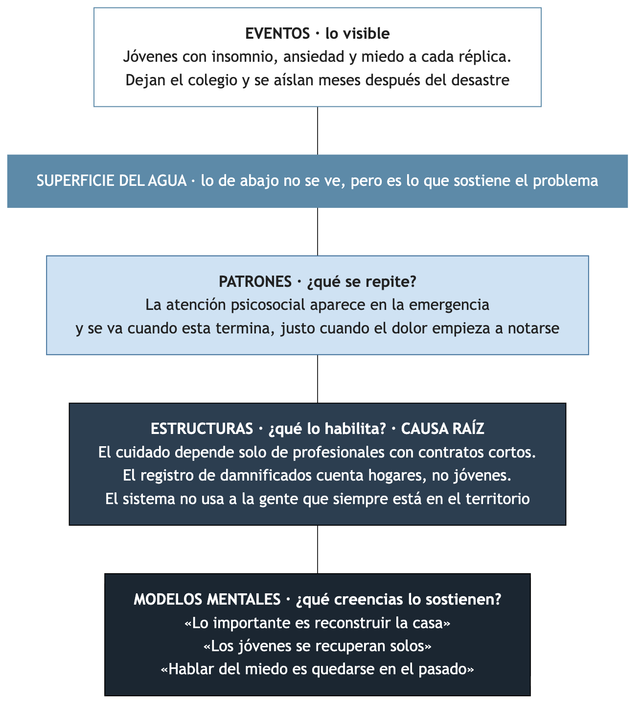
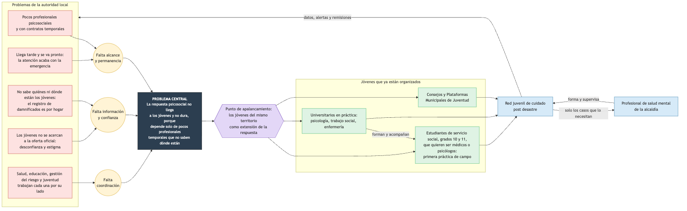

# Reto 3 GRIS: Recuperarnos después de la crisis

**Salud mental y desastres naturales**
Mental Lab Central · Global Development Forum I+D humanaMENTE+ · Universidad de La Sabana
Bogotá, 22 de octubre de 2026

---

## 1. El reto

### Pregunta de innovación

> ¿Cómo podríamos ayudar a los jóvenes afectados por desastres naturales a **reconocer y afrontar** las consecuencias emocionales de la pérdida, el miedo y la incertidumbre, y a **recuperar sus redes de apoyo** después de una crisis?

### Contexto

- Colombia convive con sismos, inundaciones y deslizamientos.
- Después de un desastre las comunidades no solo reconstruyen casas: también cargan con el duelo, la ansiedad, el miedo, la incertidumbre y la ruptura de sus rutinas.
- El reto se enfoca en **las etapas posteriores** al desastre, no en la emergencia misma.
- **Los jóvenes quedan en un lugar intermedio:** no son el foco de la atención infantil ni de la adulta.

### Clave de contexto

> El objetivo es que estos retos respondan a necesidades reales y sean útiles para **fortalecer el trabajo que se viene desarrollando junto a las autoridades locales** en materia de salud mental de los jóvenes.

### Qué no busca ningún reto

- Soluciones que reemplacen la atención profesional en salud mental.
- Diagnósticos o terapias sin respaldo clínico.
- Propuestas basadas únicamente en prohibir.

Mental Lab busca **entornos protectores, vínculos y capacidades** que complementen el sistema de salud.

### Rutas de solución sugeridas por la organización

Son inspiración, no respuestas obligatorias:

- Acompañamiento entre pares después de la crisis, con formación y supervisión.
- Rituales de memoria y duelo colectivo.
- Recuperación de rutinas y espacios seguros para jóvenes.
- Jóvenes como agentes de apoyo psicosocial en sus comunidades.
- Preparación emocional antes de la crisis, no solo después.

---

## 2. Cómo nos evalúan

| Criterio | Qué se evalúa | Peso |
|---|---|---|
| Comprensión sistémica | La solución actúa sobre una causa raíz y un punto de apalancamiento claro, no sobre síntomas | 25 % |
| Pertinencia juvenil | Responde a una necesidad real de las juventudes, con evidencia de escucha | 20 % |
| Innovación | Aporta algo distinto a lo que ya existe en el ecosistema | 20 % |
| Viabilidad y escalabilidad | Puede pilotearse con recursos razonables y aliados identificables | 20 % |
| Prototipo y pitch | El prototipo hace tangible la solución y el pitch la comunica con claridad | 15 % |

- Cada jurado califica de 1 a 5 por criterio. El puntaje es el promedio ponderado.
- **Desempate:** gana el mayor puntaje en viabilidad y escalabilidad.
- El Reto 3 compite en la **sala B** junto con el Reto 2. Pasa un ganador por reto a la final.
- **Pitch semifinal:** 3 minutos, más 3 minutos de preguntas del jurado.
- **Pitch final:** 1 minuto en el auditorio, ante Víctor Manuel Muñoz, María Paula Correa y Emilio José Archila.
- **Premio:** un diplomado de la Universidad de La Sabana para cada integrante del equipo ganador. Hay que estar toda la jornada.

### Quién nos escucha

| Persona | Rol | Qué le va a importar |
|---|---|---|
| Luisa Fernanda Vélez | Jurado | Exdirectora de Adolescencia y Juventud del ICBF ("Hablar Locura", "Es Tu Parche"). Política pública juvenil y articulación entre gobierno y sociedad civil |
| Katty Eljach | Jurado | Participó en la línea 141 del ICBF y co-creó Wilby, un chatbot de IA para acompañamiento emocional. Va a preguntar qué nos diferencia de lo que ya existe |
| Daniel Restrepo | Mentor | Creador de "Tenemos Que Hablar". La conversación y la escucha como cuidado |

Luisa Fernanda Vélez también acompaña como mentora del reto gris, así que conviene mostrarle la idea temprano y ajustarla con su retroalimentación.

### Lo que dijeron los facilitadores en la apertura

- **Las ideas se van a ejecutar.** Con todas las propuestas, no solo las ganadoras, se arman informes para gestionarlas con autoridades locales, fondos y empresas privadas. Hay que "poner los pies sobre la tierra".
- **La escucha debe ser parte de la solución**, no solo del diagnóstico: escuchar lo que hay detrás de lo que la gente dice.
- La maqueta de LEGO muestra **solo el problema**. Los mentores la revisan antes de pasar a las soluciones.
- El orden de los pitches se sortea y se pueden ver los de los demás equipos.

---

## 3. El problema central

> **Después de un desastre, la respuesta psicosocial de la alcaldía no llega a los jóvenes y no dura, porque depende solo de unos pocos profesionales de afuera que llegan tarde, se van pronto y no saben dónde están los jóvenes.**

La causa raíz no es que falten psicólogos, porque nunca va a haber suficientes. **El problema es que el sistema solo sabe cuidar con profesionales temporales y deja por fuera a los jóvenes, que son los que se quedan.**

### Iceberg

| Nivel | Qué pasa |
|---|---|
| **Eventos (lo visible)** | Jóvenes con insomnio, ansiedad y miedo a cada réplica. Dejan el colegio y se aíslan meses después del desastre |
| **Patrones** | La atención psicosocial aparece en la emergencia y se va cuando esta "termina", justo cuando el dolor empieza a notarse |
| **Estructuras (causa raíz)** | El cuidado depende solo de profesionales con contratos cortos. El registro de damnificados cuenta hogares, no jóvenes. El sistema no usa a la gente que siempre está en el territorio |
| **Modelos mentales** | «Lo importante es reconstruir la casa», «los jóvenes se recuperan solos», «hablar del miedo es quedarse en el pasado» |

---

## 4. Mapa del problema: lo que le impide a la alcaldía ser eficaz

Hipótesis a validar con el mentor y con el profesional de salud mental de la jornada:

| Problema de la autoridad local | Por qué pasa | Causa que agrupa |
|---|---|---|
| Pocos profesionales psicosociales | Los municipios pequeños tienen equipos mínimos y contratos de prestación de servicios que se acaban | Falta alcance y permanencia |
| Llega tarde y se va pronto | La atención se cierra con la emergencia, pero el duelo, la ansiedad y el abandono escolar aparecen meses después | Falta alcance y permanencia |
| No sabe quiénes ni dónde están los jóvenes | El registro de damnificados se hace por hogar. El joven no aparece y con la reubicación se pierde el rastro | Falta información y confianza |
| Los jóvenes no se acercan a la oferta oficial | Desconfianza en lo institucional y estigma de "ir al psicólogo" | Falta información y confianza |
| Cada sector trabaja por su lado | Salud, educación, gestión del riesgo y juventud no comparten información ni planes | Falta coordinación |

### Actores

- **Jóvenes afectados y sus familias.**
- **Alcaldía:** Secretaría de Salud, Secretaría de Educación, oficina de juventud.
- **Consejo Municipal de Gestión del Riesgo** y organismos de socorro.
- **Colegios y universidades.**
- **Sistema de salud.**
- **Organizaciones comunitarias,** sector privado y medios locales.
- **Quién falta y debería estar:** los propios jóvenes como actores de la respuesta, no solo como beneficiarios.

---

## 5. Punto de apalancamiento

> Los jóvenes del mismo territorio están antes, durante y después del desastre. La alcaldía no. Si los jóvenes se vuelven la extensión de la respuesta, la alcaldía gana alcance, información, confianza y continuidad sin contratar más gente.

El cambio ocurre en las tres palancas del sistema:

| Palanca | Qué cambia |
|---|---|
| **Relaciones** | El joven afectado habla con un par formado, no con un funcionario desconocido |
| **Reglas** | El servicio social obligatorio pasa a incluir el cuidado psicosocial en emergencias |
| **Información** | La alcaldía recibe datos sobre dónde están y cómo están los jóvenes, que hoy no tiene |

### Pregunta «¿Cómo podríamos...?»

> ¿Cómo podríamos convertir a los estudiantes que ya hacen servicio social en una red juvenil de cuidado que extienda el alcance y la permanencia de la respuesta psicosocial de la alcaldía después de un desastre?

---

## 6. La idea central: estudiantes de labor social

En Colombia, los estudiantes de **grados 10 y 11 deben cumplir un servicio social obligatorio** (mínimo 80 horas) para graduarse. Hoy esas horas muchas veces se gastan en tareas de poco impacto.

La idea es canalizar parte de ese servicio social hacia una **red juvenil de cuidado**:

1. **Formación:** los estudiantes aprenden Primeros Auxilios Psicológicos, que según la OMS se resumen en tres verbos: **observar, escuchar y conectar** (con su red y, si hace falta, con el profesional). No es terapia. Esto pone la escucha en el centro de la solución.
2. **Supervisión:** el profesional de salud mental de la alcaldía forma, supervisa y recibe los casos que lo necesitan.
3. **Activación:** cuando hay un desastre, el Consejo Municipal de Gestión del Riesgo activa la red.
4. **Retorno:** la red le devuelve a la alcaldía datos, alertas y remisiones.

### Por qué es fuerte

- **La estructura ya existe.** Todos los colegios tienen servicio social. No hay que crear una red desde cero, solo darle propósito.
- **Se renueva sola.** Cada año llega una cohorte nueva, así que la red no muere cuando se acaba un contrato.
- **Es par a par y se basa en la confianza.** Un joven no le abre su miedo a un funcionario que ve una vez. Se lo abre a otro joven en quien confía. Esto ataca la desconfianza y el estigma.
- **Viene desde los jóvenes.** Ellos se forman, cuidan y le devuelven información a la alcaldía.
- **Es barata y pilotable.** Usa horas que ya son obligatorias y profesionales que ya existen.

### Una ruta para futuros profesionales de la salud

La red empieza por los estudiantes de 10 y 11 que **quieren estudiar medicina, psicología, enfermería o trabajo social**. Para ellos, el servicio social deja de ser un trámite y se vuelve su **primera práctica de campo**, con formación y acompañamiento reales.

Funciona en cascada, y cada nivel acompaña al siguiente:

1. **Profesional de salud mental de la alcaldía:** supervisa toda la red y recibe los casos que necesitan atención profesional.
2. **Universitarios en práctica** de medicina, psicología, enfermería y trabajo social: forman y acompañan a los estudiantes de colegio. Para ellos cuenta como práctica comunitaria.
3. **Estudiantes de servicio social:** observan, escuchan y conectan a sus pares.

| Quién | Qué gana |
|---|---|
| Estudiante de colegio | Experiencia real en lo que quiere estudiar, orientación vocacional y un certificado de formación |
| Universitario en práctica | Horas de práctica comunitaria con impacto real |
| Universidad | Proyección social y un semillero de futuros estudiantes |
| Alcaldía | Más manos formadas y supervisadas, sin más contratos |
| Municipio a largo plazo | Jóvenes del territorio que estudian salud y pueden volver como los profesionales que hoy faltan |

**Cómo escala:** cada facultad de salud puede adoptar los colegios de uno o varios municipios. La Universidad de La Sabana, aliada metodológica del Mental Lab, es candidata natural para el piloto si tiene programas de Medicina, Psicología y Enfermería (confirmar con los facilitadores).

**Cuidado:** para los estudiantes de colegio no es práctica clínica. No atienden casos, solo observan, escuchan y conectan, siempre acompañados por un universitario y supervisados por un profesional.

Esto también ataca la causa raíz a largo plazo: si el problema es que faltan profesionales en el territorio, la red empieza a formarlos desde el colegio.

### Otra capa que la amplía

- **Consejos y Plataformas Municipales de Juventud:** dan legitimidad y voz política a la red.

---

## 7. Mapa de ideas

### Antes de la crisis

- Incluir Primeros Auxilios Psicológicos dentro de las 80 horas de servicio social.
- Simulacros que incluyan lo emocional, no solo la evacuación.
- Mapa de pares: cada estudiante sabe a quién buscar si pasa algo.

### Primeras semanas

- Censo de pares: los estudiantes ubican a cada compañero después de la reubicación y le pasan ese dato a la alcaldía.
- Espacios seguros y rutinas en el colegio o el albergue, liderados por los mismos jóvenes.
- Detectar a quien se está aislando y remitirlo por la ruta oficial.

### Meses después

- Rituales de memoria y duelo colectivo organizados por los jóvenes.
- Acompañamiento cuando el psicólogo ya se fue.
- Jóvenes con voz en los planes de reconstrucción.

### Lo que gana la alcaldía

- Más alcance sin más contratos.
- Datos sobre jóvenes que hoy no tiene.
- Profesionales enfocados en los casos que de verdad los necesitan.
- Continuidad año tras año.

### Cuidados no negociables

- **No es terapia ni diagnóstico.** Es escucha, acompañamiento y remisión. Esto respeta la regla del reto.
- **Supervisión profesional siempre.** La red responde al profesional de salud mental de la alcaldía.
- **Proteger a los estudiantes.** Muchos son menores de edad y también pueden ser damnificados. Necesitan límites claros, espacios para descargar y nunca deben quedar solos con un caso grave.

---

## 8. Borrador de la ficha de solución (Anexo A)

| Campo | Borrador |
|---|---|
| Nombre del equipo y modalidad | _Por definir_ |
| Integrantes | _Por definir_ |
| Reto | Reto 3 GRIS: Recuperarnos después de la crisis |
| Punto de apalancamiento | Los jóvenes del territorio como extensión de la respuesta psicosocial de la alcaldía, usando el servicio social obligatorio que ya existe |
| Pregunta «¿Cómo podríamos...?» | ¿Cómo podríamos convertir a los estudiantes que ya hacen servicio social en una red juvenil de cuidado que extienda el alcance y la permanencia de la respuesta psicosocial de la alcaldía después de un desastre? |
| La solución en una frase | Una red de estudiantes de servicio social que quieren ser profesionales de la salud, formados por universitarios en Primeros Auxilios Psicológicos y supervisados por la alcaldía, que encuentra, escucha y conecta a los jóvenes afectados después de un desastre |
| ¿A quién beneficia y cómo? | **Jóvenes afectados:** no se pierden y tienen a un par de confianza cerca. **Estudiantes de servicio social:** primera práctica de campo en lo que quieren estudiar. **Universitarios y universidades:** práctica comunitaria y proyección social. **Alcaldía:** alcance, datos y continuidad sin más contratos. **Municipio:** forma a sus futuros profesionales |
| Supuesto principal que validamos | Que un joven afectado se abre más con un par formado que con un funcionario, y que un colegio acepta reorientar parte de las horas de servicio social |
| Aliados para pilotearla | Secretarías de Educación y Salud, Consejo Municipal de Gestión del Riesgo, colegios, facultades de medicina, psicología y enfermería (por ejemplo, la Universidad de La Sabana), Plataforma Municipal de Juventud |
| Primer paso en los próximos 3 meses | Pilotear en un colegio de un municipio con una emergencia reciente: formar a una cohorte de 30 estudiantes en Primeros Auxilios Psicológicos y hacer un simulacro que incluya lo emocional |

---

## 9. Pitch: Entre amigos nos cuidamos

El pitch usa la maqueta de LEGO de antes y después (la casa construida y la casa destruida). Toma dos piezas como metáforas: **la grúa**, que llega para la casa y no para el joven, y **los engranajes** de la casa construida, que son los vínculos que mantienen andando a un joven. Por eso el nombre propuesto es **Entre amigos nos cuidamos**. Otra opción que salió del equipo es **Volver a florecer**.

### Pitch semifinal (3 minutos, estructura 4H)

**HEADLINE (0:00 a 0:20)** *Señalar la grúa sobre la casa destruida.*

> "Miren esta grúa. Después de un desastre, la grúa llega rápido. Llega para reconstruir la casa. Pero, ¿quién llega para el joven que vivía en ella?"

**HEART (0:20 a 1:00)** *Señalar la casa construida.*

> "Esto es el antes: una casa, un colegio, amigos, una rutina. Estos engranajes son eso: los vínculos que mantienen andando a un joven."

*Pasar a la casa destruida.*

> "Esto es el después. No solo se cae la casa. Se caen los engranajes: se cierra el colegio, la familia se reubica, los amigos terminan en otro albergue. Y llegan el miedo con cada réplica, el insomnio y el duelo. Los jóvenes quedan en medio: no son niños ni adultos, y por eso nadie los tiene en su lista."

**HEAD (1:00 a 2:15)**

> "La alcaldía sí envía psicólogos. Pero son pocos, tienen contratos de meses y se van cuando termina la emergencia, justo cuando el dolor empieza a notarse. Además, el registro de damnificados cuenta hogares, no jóvenes, así que ni siquiera saben dónde están.
>
> El problema no es que falten psicólogos, porque nunca va a haber suficientes. El problema es que el sistema solo sabe cuidar con gente de afuera que se va. Y un joven no le abre su miedo a un funcionario que ve una vez. Se lo abre a alguien en quien confía: a otro joven.
>
> Ese joven ya existe. Todos los colegios de Colombia tienen una estructura que nadie usa para esto: el **servicio social obligatorio**, 80 horas que todo estudiante de grado 10 y 11 debe cumplir.
>
> **Entre amigos nos cuidamos** empieza por los estudiantes que sueñan con ser médicos, psicólogos o enfermeros. Su servicio social se vuelve su primera práctica de campo. Los forman y acompañan universitarios de esas carreras, y los supervisa el psicólogo de la alcaldía. Aprenden Primeros Auxilios Psicológicos, que se resumen en tres verbos: **observar, escuchar y conectar**. Conectar al joven con su red y, si lo necesita, con el profesional. No son terapeutas: son futuros profesionales aprendiendo a cuidar.
> - **Antes del desastre:** simulacros que incluyen lo emocional, y cada estudiante sabe a quién buscar.
> - **Después:** ubican a cada compañero tras la reubicación, sostienen rutinas en el albergue y detectan a quien se está aislando para conectarlo con ayuda.
> - **Meses después:** siguen ahí cuando el psicólogo ya se fue.
>
> La alcaldía gana alcance sin firmar más contratos, recibe datos que hoy no tiene y sus psicólogos se concentran en los casos graves."

**HOPE (2:15 a 3:00)**

> "Cada año sale una promoción y entra otra. Esta red no depende de un contrato: ya existe en cada colegio del país, solo hay que activarla. Y crece con las universidades: cada facultad de medicina o psicología puede adoptar los colegios de un municipio. Para empezar necesitamos un colegio, una facultad, una secretaría de salud y 30 estudiantes. En tres meses tenemos el primer piloto. Y quizás, de esos 30, salgan los psicólogos que ese municipio nunca tuvo."

*Volver a señalar la grúa.*

> "**La grúa reconstruye la casa. Los jóvenes reconstruyen a los jóvenes.**"

### Versión de 1 minuto (para la final)

> "Después de un desastre, la grúa llega para la casa, pero nadie llega para el joven. Los psicólogos de la alcaldía son pocos, se van cuando acaba la emergencia y no saben dónde quedaron los jóvenes. Pero hay alguien que sí se queda y en quien sí confían: otros jóvenes. Entre amigos nos cuidamos usa el servicio social obligatorio para que los estudiantes de 10 y 11 que quieren ser médicos o psicólogos hagan su primera práctica de campo: formados por universitarios de esas carreras en Primeros Auxilios Psicológicos (observar, escuchar y conectar) y supervisados por la alcaldía. Ellos ubican a sus compañeros, los escuchan y conectan con ayuda profesional a quien la necesita. La alcaldía gana alcance sin más contratos, cada año llega una nueva promoción y el municipio empieza a formar a sus propios profesionales. La grúa reconstruye la casa. Los jóvenes reconstruyen a los jóvenes."

### Cómo repartirlo entre los tres

- **Persona 1:** Headline y Heart, con la maqueta.
- **Persona 2:** Head (problema y solución).
- **Persona 3:** Hope y el cierre, y luego responde las preguntas.

### Ideas para el prototipo

- **Storyboard en video corto** del recorrido de la red (antes, después y meses después). Lo puede liderar el integrante que hace producción audiovisual.
- **Mockup sencillo** de cómo la red le reporta a la alcaldía: dónde está cada joven, alertas y remisiones. Lo puede liderar el integrante que es ingeniero de software.
- La tecnología es un apoyo, no el centro de la idea. Katty Eljach ya creó un chatbot de acompañamiento emocional (Wilby), así que el diferencial tiene que ser la red de personas.

### Preguntas probables del jurado

| Pregunta | Respuesta corta |
|---|---|
| "¿No es riesgoso poner a menores a atender a damnificados?" | No hacen terapia, solo observan, escuchan y conectan. Siempre trabajan supervisados, nunca se quedan solos con un caso grave y la red también los cuida a ellos. |
| "¿En qué se diferencia de un chatbot o de una línea de atención?" | Una línea espera a que el joven llame. Esta red lo busca, sabe dónde quedó después de la reubicación y es alguien en quien ya confía. |
| "¿Quién lo paga y quién lo firma?" | Casi no cuesta: las horas de servicio social ya son obligatorias. Firman las Secretarías de Educación y Salud, y el Consejo de Gestión del Riesgo activa la red. |
| "¿Cómo saben que los jóvenes lo quieren?" | Es el supuesto principal que validamos en el piloto: que un joven afectado se abre más con un par formado que con un funcionario. |
| "¿Por qué un estudiante elegiría esto y no un servicio social más fácil?" | Porque es su primera experiencia real en lo que quiere estudiar, con formación de universitarios y un certificado. No es un trámite: es orientación vocacional. |
| "¿Qué gana la universidad?" | Horas de práctica comunitaria para sus estudiantes, proyección social y un semillero de futuros estudiantes de medicina y psicología. |

---

## 10. Preguntas para validar con el mentor y el profesional de salud mental

1. ¿Es realista que una alcaldía acepte el servicio social como parte de su respuesta psicosocial? ¿Quién firma eso?
2. ¿Qué tanto se pierde el rastro de los jóvenes después de una reubicación?
3. ¿Cuál es el límite seguro de lo que puede hacer un estudiante de 15 a 17 años en un contexto de duelo?
4. ¿Ya existe algo parecido en algún municipio? Así evitamos repetir y sumamos en innovación.
5. ¿Qué pasa si el colegio mismo quedó destruido? ¿Dónde se reúne la red?

---

## Anexo: agenda del día

| Hora | Momento | Producto |
|---|---|---|
| 10:00 | Conectar: check-in, acuerdo de equipo y roles (guardián del tiempo, relator, vocero) | Equipo cohesionado |
| 10:20 | Comprender: Iceberg, mapa de actores y punto de apalancamiento con LEGO | Pregunta «¿Cómo podríamos...?» |
| 11:00 a 12:50 | Crear: divergencia, polinización cruzada y convergencia | Concepto de solución |
| 2:10 a 3:00 | Experimentar: prototipo, prueba cruzada y mentoría | Prototipo de baja fidelidad |
| 3:00 a 3:25 | Preparar: pitch 4H, ficha de solución y ensayo | Pitch y ficha |
| 3:30 | Movilizar: pitches en paralelo, sala B para los retos 2 y 3 | Soluciones presentadas |
| 4:30 | Premiación semifinal | Ganador por reto |
| 4:45 a 5:00 | Pitch final y premiación en el auditorio | Ganadores |

> Ojo: la ficha técnica dice que la ficha de solución se entrega a las 2:25 p. m., pero la preparación del pitch está a las 3:00. Confirmar la hora con un facilitador.
