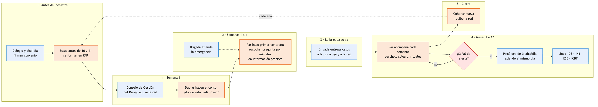

# Blueprint de servicio: "Entre amigos nos cuidamos"

El blueprint muestra, fase por fase, lo que ve el joven, lo que hace la red frente a él, lo que pasa detrás y lo que lo sostiene. La línea de visibilidad separa lo que el joven ve de lo que no ve.

## Tabla del blueprint

| | **0. Antes del desastre** | **1. Semana 1: activación** | **2. Semanas 1 a 4: con la brigada** | **3. Entrega: la brigada se va** | **4. Meses 1 a 12: seguimiento** | **5. Cierre y cohorte nueva** |
|---|---|---|---|---|---|---|
| **Evidencia física** | Chaleco y carné de la red. Tarjeta de bolsillo | Mensaje de WhatsApp de la alcaldía. Punto de la red en el albergue | Ficha de primer contacto. Cartel "aquí hay alguien de tu edad" | Carpeta de entrega (casos con consentimiento) | Tarjeta de bolsillo con la ruta 106 y 141. Calendario de encuentros | Certificado de servicio social. Muro de memoria en el colegio |
| **Lo que hace el joven afectado** | Ve a la red en el simulacro del colegio | Llega al albergue o a casa de familiares | Habla con un par. Pide ayuda con su mascota, su colegio, sus amigos | No nota el cambio: el mismo par sigue ahí | Vuelve a un parche, al colegio. Si lo necesita, llega a la psicóloga | Algunos se forman en la cohorte siguiente |
| **Frente: el estudiante de la red** | Se forma en Primeros Auxilios Psicológicos (8 h virtuales más 16 h presenciales) | Se activa en dupla. Hace el censo de compañeros: quién está dónde | Primer contacto: escuchar, preguntar por animales, dar información práctica | Recibe sus casos de la brigada junto con la psicóloga | Contacto cada semana o cada 15 días. Organiza parches y rituales. Detecta señales de alerta | Despedida. Entrega sus casos a la cohorte nueva |
| *línea de visibilidad* | | | | | | |
| **Detrás: la psicóloga de la alcaldía** | Dicta o coordina la formación con Cruz Roja y la universidad | Asigna zonas y duplas. Revisa el censo | Supervisión semanal. Recibe remisiones urgentes el mismo día | Recibe la carpeta. Prioriza casos con el tablero | Supervisión y espacio de descarga de los estudiantes. Atiende los casos remitidos | Evalúa resultados. Ajusta la formación |
| **Soporte: sistemas y aliados** | Convenio colegio y alcaldía (modelo Bomberos Bogotá). Póliza. Componente juvenil en la Estrategia Municipal de Respuesta | El Consejo Municipal de Gestión del Riesgo activa la red | Brigadas (Cruz Roja, MSF, ICBF, universidades). Centro de bienestar animal | Protocolo de entrega de casos | Plan de Intervenciones Colectivas (PIC). Línea 106, Línea 141, ESE, Unidades Móviles del ICBF. Practicantes de la universidad local | Secretaría de Educación certifica las horas. Colegio abre la cohorte nueva |

## Momentos críticos (donde puede fallar)

| Momento | Riesgo | Cómo lo evitamos |
|---|---|---|
| Activación | Los estudiantes también son damnificados | Tamizaje de bienestar antes de activar. Quien esté afectado hace otro servicio, sin castigo |
| Primer contacto | Que el estudiante pida contar lo vivido | Guion cerrado: se pregunta por el presente y lo práctico, nunca "cuéntame qué pasó" |
| Señal de alerta | Ideas suicidas o abuso | Se avisa a la psicóloga el mismo día. Ningún secreto de riesgo. Nunca solo con un caso grave |
| Entrega | La brigada se va sin entregar | El protocolo de entrega queda en la Estrategia Municipal de Respuesta |
| Meses 3 a 12 | La red se desgasta | Turnos cortos, duplas, espacio de descarga quincenal con la psicóloga |
