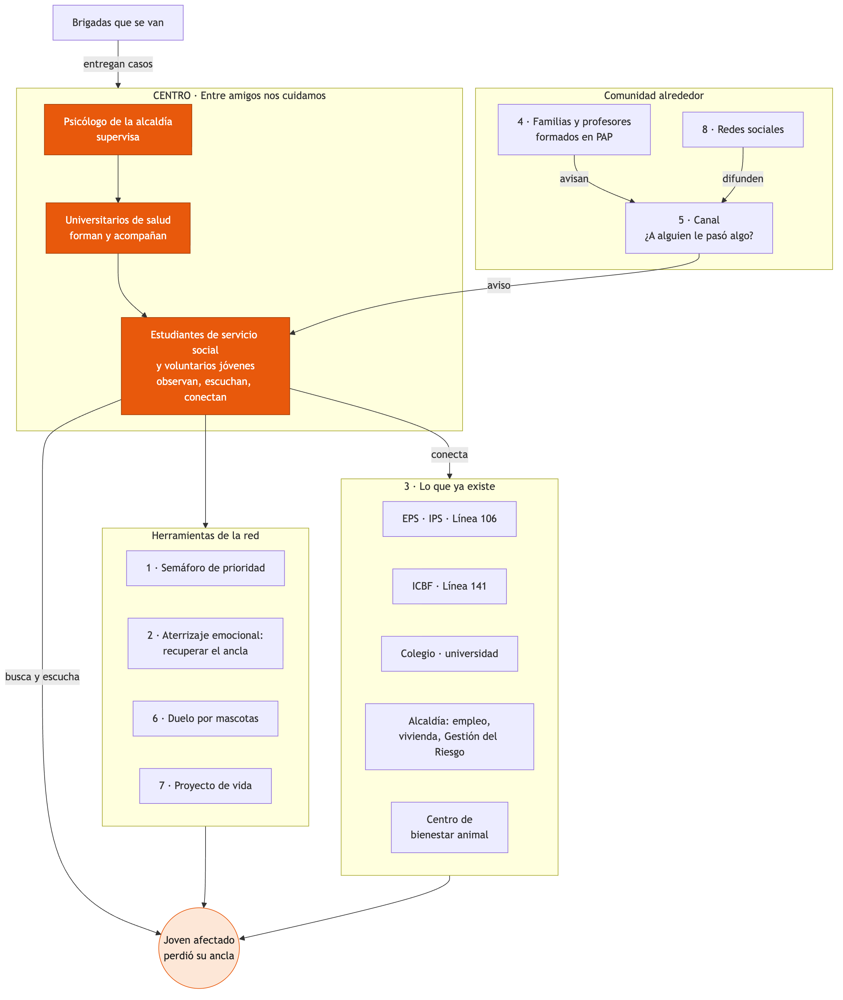

# Solución: Entre amigos nos cuidamos

**Reto 3 GRIS, Mental Lab Central. Bogotá, 22 de octubre de 2026.**

> **En una frase:** una solución compuesta que tiene en el centro una red de jóvenes (estudiantes de servicio social y voluntarios que quieren ser médicos, psicólogos o enfermeros), formados por universitarios y supervisados por la alcaldía. Después de un desastre, la red encuentra a cada joven afectado, lo escucha, prioriza según cuánto le pegó, le ayuda a recuperar su "ancla" y lo conecta con lo que ya existe. Alrededor, una comunidad formada (familias y profesores), y un aviso "entre amigos nos cuidamos" (el amigo que ve memes tristes comparte el post con la cuenta de la red) hacen que nadie quede por fuera. Y la red se queda cuando las brigadas se van.

*"La grúa reconstruye la casa. Entre amigos, nos cuidamos."*

---

## 1. La metáfora de la maqueta

| Pieza | Qué representa |
|---|---|
| **La casa construida (antes)** | Una comunidad activa en lo económico, lo ambiental y lo emocional. El joven tiene su rutina y una red de apoyo directa: familia, amigos y tutores. La casa es seguridad y refugio, pero sobre todo es un **ancla emocional**: lo amarra a un ser querido, a su mascota, a su cuarto, a sus planes |
| **La casa destruida (después)** | Llega el miedo a que se repita y la incertidumbre. Se pierde **el ancla**: el cuarto propio, el carro que aún no se terminaba de pagar, la mascota, el plan de sacar un crédito para la casa. El daño emocional va más allá de lo material |
| **La grúa** | La ayuda que llega para reconstruir la casa, no para el joven |
| **Los engranajes** | Los vínculos que mantienen andando a un joven. La red Entre amigos nos cuidamos los vuelve a hacer girar |

---

## 2. Cómo pensamos la solución

1. **Es compuesta, pero con un centro.** La red de jóvenes es el corazón. Las demás piezas (comunidad formada, canal de aviso, redes sociales) son los engranajes que la conectan con todos. Sin la red, las piezas sueltas no se hablan.
2. **Casi todo ya existe.** Innovar es tomar lo que hay (servicio social, prácticas universitarias, EPS, alcaldía, ICBF, líneas de ayuda) y hacerlo más efectivo, no reinventar la rueda.
3. **Sostenible, no asistencialismo de una semana.** Dura meses después del desastre y queda lista para el próximo.
4. **Prioriza por nivel de afectación.** No a todos les pegó igual.
5. **Mira hacia adelante.** Además del duelo, el joven recupera su ancla y su proyecto de vida.
6. **Crea cultura ciudadana.** Una sociedad que no es indiferente: jóvenes, familias y profesores saben cómo ayudar al vecino al que se le cayó la casa.

---

## 3. El problema

> Después de un desastre, la respuesta psicosocial no llega a los jóvenes y no dura. Depende de pocos profesionales que llegan tarde, se van pronto y no saben dónde están los jóvenes. Y los jóvenes quedan en medio: no son niños ni adultos, así que nadie los tiene en su lista.

**La causa raíz no es que falten psicólogos** (nunca va a haber suficientes). Es que el sistema solo sabe cuidar con gente de afuera que se va, y deja por fuera a los únicos que siempre se quedan: los jóvenes del territorio y su comunidad.

### Lo que escuchamos (evidencia de escucha)

- **Cali, sismo de 2026:** estudiantes que tuvieron que cancelar el semestre y padres que perdieron su negocio, su empresa o su trabajo.
- **Jóvenes que estaban construyendo su futuro:** los que pensaban endeudarse para una casa o pagaban un carro sienten que sus planes se ahogan. A eso se suma la angustia de reconstruir desde cero y lo que cuesta.
- **Miedo a que se repita:** con cada réplica vuelve el miedo, y aparece la incertidumbre.
- **Chocó:** los voluntarios de psicología estuvieron poco tiempo. En El Carmen de Atrato (2024) las familias dijeron que la ayuda "solo duró unas semanas".
- **Mascotas:** niños y jóvenes muy apegados sufren especialmente cuando la mascota desaparece y no saben qué le pasó.
- **No a todos les pega igual:** unos perdieron la casa, otros un familiar, otros el semestre.
- **La gente quiere ayudar pero no sabe cómo:** muchas veces alguien ve que a otro le pasó algo y no sabe a quién avisar.

### Datos que lo respaldan (ver `investigacion/`)

- Sismo del 10 de agosto de 2026 en Chocó: magnitud 7,4 y más de 300 muertos. La OPS señala la salud mental como la **brecha principal** de la respuesta.
- El Chocó tiene **un solo servicio de salud mental habilitado**, en Quibdó.
- En el Chocó, el **74 %** de los intentos de suicidio entre 2021 y 2025 fueron de niños, adolescentes y jóvenes. Los casos por año pasaron de 55 a 123.
- Las brigadas llegan cerca de una semana tarde a lo psicológico y se quedan de días a 3 meses.
- Después de Katrina, perder la mascota predijo más malestar incluso descontando el duelo por personas, y el efecto fue mayor en los más jóvenes.

---

## 4. Las piezas de la solución

### Centro: la red Entre amigos nos cuidamos

Funciona en cascada:

| Nivel | Quién | Qué hace | Qué gana |
|---|---|---|---|
| 1 | **Psicólogo de la alcaldía** (Secretaría de Salud, PIC) | Supervisa toda la red y atiende los casos que necesitan un profesional | Llega a más jóvenes y se enfoca en los casos graves |
| 2 | **Universitarios en práctica** de medicina, psicología, enfermería y trabajo social | Forman y acompañan a los estudiantes. Son la supervisión cercana | Horas de práctica comunitaria con impacto real |
| 3 | **Estudiantes de servicio social (grados 10 y 11) y voluntarios jóvenes** que quieren estudiar carreras de salud | Observan, escuchan y conectan a sus pares | Primera práctica de campo en lo que quieren estudiar, orientación vocacional y certificado |

Los estudiantes **no hacen terapia ni diagnóstico**. Hacen Primeros Auxilios Psicológicos, que según la OMS son tres verbos: **observar, escuchar y conectar**.

**Regla de oro: nadie queda sin alguien.** Cuando la brigada (Cruz Roja, MSF, ICBF o universidades) se va, entrega sus casos a la red con el consentimiento de cada joven.

### Pieza 1. Caracterización: el semáforo de prioridad

Sirve para priorizar sin diagnosticar. El estudiante **no pregunta por el trauma**: anota lo que el joven perdió y lo que observa. El color lo **confirma el supervisor**, nunca el estudiante solo.

| Qué se anota | Ejemplos |
|---|---|
| Pérdidas | Casa, cuarto propio, familiar o ser querido, mascota (muerta o perdida), colegio o semestre, trabajo o negocio de la familia, carro o crédito |
| Ancla | ¿Qué era lo que más lo amarraba? (una persona, la mascota, su cuarto, un plan) |
| Señales que se observan | No duerme o no come hace días, se aísla, no volvió a estudiar, miedo intenso con cada réplica, habla de no querer vivir |
| Lo que pide | Información del colegio, ubicar a amigos, buscar su mascota, volver a una actividad |

| Color | Qué significa | Qué hace la red |
|---|---|---|
| 🟢 Verde | Tuvo pérdidas pero se sostiene y tiene red | Acompañamiento cada 15 días, rutinas y parches |
| 🟡 Amarillo | Varias pérdidas o señales que preocupan | Acompañamiento semanal, revisado con el supervisor |
| 🔴 Rojo | Señales graves o riesgo para su vida | Se llama al psicólogo **el mismo día**. El estudiante nunca se queda solo con el caso |

### Pieza 2. Aterrizaje emocional: recuperar el ancla

Si el desastre se llevó el ancla, el primer paso es ayudar al joven a **aterrizar** en algo estable otra vez. No se trata de reemplazar lo que se perdió, sino de tener de nuevo algo de dónde agarrarse:

- **Un lugar propio:** un rincón, un horario o un espacio en el albergue o en la casa de acogida que sea "suyo".
- **Una rutina:** volver a un parche de fútbol, música o estudio a la misma hora, con sus pares.
- **Una persona:** reencontrar a sus amigos tras la reubicación (la red los ubica).
- **Su mascota:** buscarla o, si murió, despedirla (ver pieza 6).
- **Un plan:** un primer paso concreto hacia su proyecto de vida (ver pieza 7).

Contra el miedo a que se repita, la red comparte información confiable (qué es una réplica, qué hacer, dónde está el punto seguro) y practica con ellos el plan de emergencia. Saber qué hacer baja la incertidumbre.

### Pieza 3. Conectar con lo que ya existe

La red no crea servicios nuevos. Lleva a cada joven a la puerta correcta:

| Lo que detecta la red | A dónde lo conecta |
|---|---|
| Necesita atención psicológica | Psicólogo de la alcaldía, su **EPS o IPS** (estar afiliado da derecho a consulta) o la Línea 106 |
| Riesgo para su vida | Psicólogo de la alcaldía el mismo día y la Línea 106 |
| Niño o adolescente sin protección | ICBF y Línea 141 |
| Perdió el colegio o canceló el semestre | Secretaría de Educación y bienestar universitario de su universidad |
| Su familia perdió el trabajo o el negocio | Oferta de empleo y reactivación económica de la alcaldía y de la caja de compensación |
| Tenía un crédito o un carro sin pagar | Orientación para pedir alivios a su banco *(confirmar si la Superintendencia Financiera dio medidas para el sismo de 2026)* |
| Perdió la casa | Programas de vivienda y reconstrucción de la alcaldía y de la UNGRD |
| Mascota perdida | Centro de bienestar animal y brigadas veterinarias |

### Pieza 4. Una comunidad que no es indiferente

La red forma también a **familias y profesores** en Primeros Auxilios Psicológicos básicos (los universitarios dan talleres cortos). Así la sociedad no se queda mirando: sabe reconocer cuando un joven no está bien, cómo hablarle y a quién avisar. Esto es la cultura ciudadana que buscamos.

### Pieza 5. "Entre amigos nos cuidamos": el aviso

Esta pieza ataca la **primera fricción: que el joven pida ayuda**. Muchas veces no la pide ("yo no estoy loco"), pero sí expresa lo que siente en redes: memes tristes, historias, publicaciones a las 2 de la mañana. Y los primeros en verlo son sus amigos.

**Cómo funciona:**
1. **El amigo avisa.** Comparte la publicación con la cuenta de Instagram de la red (@entreamigosnoscuidamos) o toca un botón de "Me preocupa mi amigo" (en la bio de la cuenta, con un enlace). Una familia, un profesor o un vecino también pueden avisar por el WhatsApp de la red.
2. **La cuenta le agradece al amigo** y le dice qué hacer mientras tanto. Nunca le revela a la persona quién avisó.
3. **Piñón le escribe al joven.** Piñón es la mascota de la red, un golden retriever con chaleco rojo. Detrás de la cuenta hay un estudiante de la red, formado y supervisado, que le escribe un "¿cómo estás?" sin juicios.
4. **Si el joven responde, entra a la red:** semáforo, acompañamiento y conexión con lo que ya existe.

**Lo que no es:**
- **No es un chatbot ni una inteligencia artificial que diagnostica.** La tecnología, si se usa, solo ordena los avisos (de qué municipio vienen, cuáles parecen urgentes). Quien lee, escribe y decide es una persona. El rojo lo confirma un psicólogo.
- **No es una intervención psicológica de un aficionado.** El estudiante escucha y conecta. Lo clínico lo hace el profesional.
- **No es vigilancia.** Solo llega lo que un amigo decide compartir. No se rastrean perfiles ni se publica nada.
- **No reemplaza la Línea 106.** Si el aviso habla de riesgo para la vida, la cuenta responde de inmediato con la 106 y el psicólogo de la alcaldía activa la ruta ese mismo día.

**Por qué es distinto del botón de reporte que ya tiene Instagram:** ese botón manda recursos genéricos. Entre amigos nos cuidamos conecta a una persona real del mismo territorio, que acompaña durante meses y lleva al joven a la ruta de su municipio. Así ataca también la **segunda fricción: que la ayuda dure**.

### Pieza 6. Duelo por mascotas

- En el primer contacto siempre se pregunta: "¿tenías algún animal?".
- Se valida la pérdida. Nunca se dice "era solo un perro".
- Si está **perdida**, se publica su foto y se cruza con el centro de bienestar animal. Reencontrarla es probablemente el mejor apoyo posible.
- Si **murió**, se ofrece un ritual de despedida voluntario (un muro de fotos, un árbol).
- Las normas colombianas sobre animales en emergencias (Ley 2474 de 2025) hablan de rescate y albergues, pero no del duelo. Después del sismo, solo en Cali quedaron 367 animales desaparecidos.

### Pieza 7. Proyecto de vida

En los meses siguientes, la red acompaña al joven a dar un paso hacia su futuro: volver al colegio, retomar el semestre, pensar qué quiere estudiar. Para muchos estudiantes de la red, ese futuro es justamente una carrera de salud.

### Pieza 8. Redes sociales

Las redes sociales son donde ya están los jóvenes. La red las usa para:

- **Normalizar:** mensajes cortos hechos por jóvenes, del tipo "lo que sientes después de un desastre es normal y no tienes que pasarlo solo" (como la campaña "All Right?" de Christchurch).
- **Informar:** dónde hay ayuda, qué colegios abrieron, qué hacer en una réplica.
- **Reencontrar:** mascotas perdidas y amigos dispersos tras la reubicación.
- **Convocar:** parches, rituales de memoria y formaciones.
- **Invitar a avisar:** difundir la cuenta @entreamigosnoscuidamos y el botón "Me preocupa mi amigo", con Piñón como cara de la red.

**Cuidado:** nunca se publican casos, nombres ni fotos de jóvenes afectados sin consentimiento, y solo se difunde información confirmada por la alcaldía.

---

## 5. Los cuatro momentos

| Momento | Qué pasa |
|---|---|
| **Antes del desastre** | Los estudiantes se forman (curso virtual gratuito de ARL Positiva, más formación presencial con universitarios y Cruz Roja). Talleres para familias y profesores. Simulacros que incluyen lo emocional. Cuenta @entreamigosnoscuidamos, botón de aviso y WhatsApp listos |
| **Primeras semanas** | El Consejo Municipal de Gestión del Riesgo activa la red. Las duplas ubican a cada compañero, hacen el primer contacto, llenan el semáforo y buscan mascotas. Llegan avisos de amigos, familias y profesores |
| **Cuando la brigada se va** | La brigada entrega los casos. El psicólogo reparte los verdes y amarillos entre las duplas y se queda con los rojos |
| **Meses 1 a 12** | Aterrizaje emocional, rutinas, rituales de memoria y proyecto de vida. Cada año entra una cohorte nueva |

---

## 6. Lo que nos hace distintos

- **Recibe los casos cuando la brigada se va.** No encontramos a nadie que haga esto hoy.
- **Va a buscar al joven.** Una línea o un chatbot esperan a que el joven escriba. La red sabe dónde quedó y es alguien en quien confía. Y la comunidad avisa.
- **Prioriza por nivel de afectación** sin diagnosticar.
- **Trabaja el ancla, no solo el dolor:** el cuarto, la mascota, el plan, la rutina.
- **Incluye el duelo por mascotas,** que nadie atiende.
- **Forma a los profesionales que faltan.** De esos estudiantes pueden salir los psicólogos y médicos que el municipio nunca tuvo.

---

## 7. Por qué ataca la causa raíz (comprensión sistémica)

| Palanca | Qué cambia |
|---|---|
| **Relaciones** | El joven habla con un par en quien confía, y su familia, sus profesores y sus vecinos saben cómo ayudar |
| **Reglas** | El servicio social y las prácticas universitarias incluyen el cuidado psicosocial en emergencias. La entrega de casos queda en el plan de respuesta del municipio |
| **Información** | La alcaldía sabe por primera vez dónde están los jóvenes, cómo están y a quién priorizar. Los jóvenes reciben información confiable que baja la incertidumbre |

Modelo mental que cambia: de "los jóvenes se recuperan solos" y "lo importante es reconstruir la casa" a "los jóvenes recuperan a los jóvenes, y la comunidad no es indiferente".

---

## 8. Por qué es viable

### Lo que ya existe y usamos

| Pieza | Respaldo |
|---|---|
| Servicio social de 80 horas | Ley 115 de 1994 y Res. 4210 de 1996, que ya permiten trabajo en salud y prevención |
| Figura legal de la red | Ley 2460 de 2025: crea los "agentes comunitarios en salud mental" y ordena formar a la comunidad en primeros auxilios psicológicos |
| Precedente | Bomberos Bogotá ya tiene servicio social en gestión del riesgo, con póliza para los estudiantes (Res. 0427 de 2026) |
| Prácticas universitarias | La Ley 2460 (art. 34) promueve prácticas de estudiantes de salud en comunidades en riesgo |
| Activación | Ley 1523 de 2012: Consejo Municipal de Gestión del Riesgo y Estrategia Municipal de Respuesta |
| Contenido de la formación | Primeros Auxilios Psicológicos de la OMS, "PFA for Young Peers" de la Cruz Roja Internacional y "Retorno a la Alegría" de UNICEF |
| Canal y redes sociales | WhatsApp y redes gratuitas. El contenido lo hacen los mismos jóvenes |

### Cuánto cuesta y quién paga

- **Piloto de 3 meses, 1 municipio, 30 estudiantes:** unos **24 millones de pesos en efectivo** y más de 40 millones en aportes en especie (horas de servicio social, universitarios en práctica, psicólogo que ya está en nómina). Los talleres para familias, el canal y las redes casi no suman costo porque los hacen los universitarios y los estudiantes.
- **Quién paga:** el Plan de Intervenciones Colectivas (PIC) y el Fondo Municipal de Gestión del Riesgo, que el municipio ya tiene.
- **Cómo se sostiene:** vender cursos de Primeros Auxilios Psicológicos a empresas para financiar la red gratuita.
- **Cómo escala:** cada facultad de salud adopta los colegios de un municipio, y cada municipio nuevo repite el modelo con sus propios fondos de ley.

---

## 9. Cuidados no negociables

- **No es terapia ni diagnóstico.** Observar, escuchar y conectar.
- **Nunca se pide contar lo vivido.** Se pregunta por el presente, por el ancla y por lo práctico.
- **Duplas, turnos cortos y supervisión siempre.** Ningún estudiante se queda solo con un caso rojo.
- **Los estudiantes también son damnificados.** Quien esté afectado hace otro servicio sin castigo, y todos tienen un espacio para descargar.
- **Privacidad.** Nada de casos, nombres ni fotos de jóvenes afectados en redes sociales.
- **El aviso entre amigos no reemplaza la Línea 106** y nunca revela quién avisó. El riesgo para la vida va directo al profesional.
- **Adaptación cultural.** En el Chocó, jóvenes afro y Embera del mismo territorio, con sus formas propias de duelo.

---

## 10. Primer paso (próximos 3 meses)

1. Elegir un municipio afectado por el sismo de 2026 y un colegio.
2. Firmar el convenio entre el colegio, la alcaldía y una facultad de salud (modelo Bomberos Bogotá, con póliza).
3. Abrir la cuenta @entreamigosnoscuidamos (costo cero), formar a 30 estudiantes y dar un taller a familias y profesores.
4. Activar la red y medir antes y después:
   - jóvenes ubicados;
   - jóvenes acompañados por color del semáforo;
   - remisiones efectivas;
   - avisos recibidos de amigos y cuántos jóvenes respondieron a Piñón;
   - jóvenes que volvieron a estudiar;
   - mascotas reencontradas.

**Supuesto principal a validar:** un joven afectado acepta más el acompañamiento de un par formado de su territorio que el de un profesional de afuera.

---

## 11. Dónde está el resto

| Qué | Dónde |
|---|---|
| **Pitch final de 3 minutos (versión 2)** | `prototipo/pitch-final.md` |
| Prompt para generar el prototipo en diapositivas con Piñón | `prototipo/prompt-prototipo.md` |
| Pitch anterior con la maqueta y versión de 1 minuto | `ideation/reto3-ideacion.md`, sección 9 |
| Ficha de solución (Anexo A) y otra versión del pitch | `prototipo/ficha-y-pitch.md` |
| Storyboard, blueprint, role-play, materiales, maqueta y one pager | `prototipo/` |
| Investigación con fuentes | `investigacion/README.md` |
| Las 35 ideas y la convergencia | `ideation/divergencia.md` |

## Pendientes

- Nombre del equipo e integrantes para la ficha.
- Confirmar con un facilitador si la Universidad de La Sabana tiene Medicina, Psicología y Enfermería, para proponerla como aliada.
- Confirmar si la ficha se entrega a las 2:25 o a las 3:00.
- Precisar la idea de "caracterización de agua" que salió en la discusión. Por ahora quedó como el semáforo de la pieza 1.
- Confirmar si hay alivios financieros de la Superintendencia Financiera para los afectados por el sismo de 2026.
